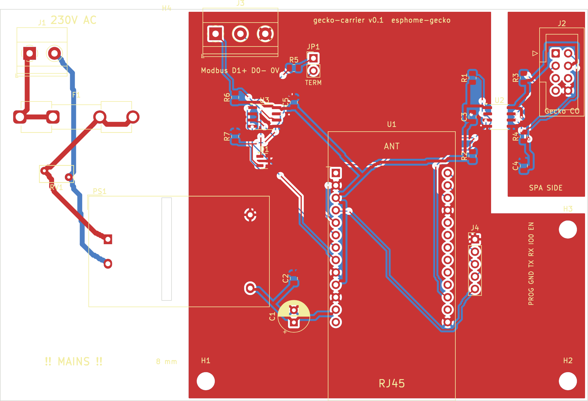

# Gecko carrier board

Carrier PCB for the [WT32-ETH01 + ATV32 config](../esphome/spa-controller-wt32-eth01-atv32.yaml): a WT32-ETH01 (ESP32 with wired Ethernet) on sockets, the spa's CO port isolated through an ISO1540, an RS485 port for the pump drives and an on-board 230 V power supply.



**Status: v0.1, not built yet.** The board passes DRC and every net is routed, but nobody has made or tested one. Check it in KiCad before you order it.

## What's on it

| Block | Parts | Notes |
|---|---|---|
| Mains | J1 (L, N), F1 T250mA 5x20, RV1 275 VAC varistor, PS1 HLK-PM01 (5 V / 0.6 A) | Left-hand third of the board. 8 mm keep-out band plus a milled slot under PS1 separate it from everything else; closest mains-to-SELV copper is 10 mm. |
| ESP32 | U1 WT32-ETH01 on 2x 1x13 female headers, C1/C2 on 5 V | RJ45 overhangs the bottom edge. Powered on its 5V pin only. |
| Programming | J4: GND, TX, RX, IO0, EN | 3.3 V USB-UART adapter. Pull IO0 to GND while resetting to flash. |
| Spa I2C | U2 ISO1540, J2 2x4 IDC header to the Gecko CO port, R1/R2 4k7 pull-ups on the ESP side | Barrier under U2: separate ground pours (GND / GND_SPA) with a keep-out in between. R3/R4 (spa-side pull-ups) are not fitted - the pack has its own. |
| RS485 | U3 MAX3485, D1 SM712, R6/R7 680R bias, R5 120R + JP1 termination, J3 terminal (D1/A+, D0/B-, 0V) | Fit JP1 if the board is at one end of the bus. |

Pin use matches the ESPHome config: I2C SDA IO4, SCL IO32; RS485 TX IO17, RX IO5, DE/RE IO33.

## Before you power it

- **Mains.** Only someone qualified should wire J1. Put the board in a closed, IP-rated enclosure; the spa compartment is damp. Use plastic screws (or no screw) in H4, which sits in the keep-out band.
- **CO-port pinout.** J2 uses the numbering from [`pictures/spa_pinouts.png`](../pictures/spa_pinouts.png): 2 SCL, 3 SDA, 4 5V, 8 GND (6 = 12 V, not used). Before the first connection, measure about 5 V between pins 4 and 8 at the cable end. Mirror the cable if it is the wrong way round.
- **WT32-ETH01 orientation.** Antenna end towards the top (ANT on the silkscreen), RJ45 over the bottom edge.

## Files

| Path | What |
|---|---|
| `gecko-carrier/gecko-carrier.kicad_pro` / `.kicad_sch` / `.kicad_pcb` | KiCad 7 project |
| `gecko-carrier/gecko_carrier.kicad_sym`, `gecko_carrier.pretty/` | Project symbols and the WT32-ETH01 footprint |
| `gecko-carrier/fab/gecko-carrier-gerbers.zip` | Gerbers + drill files for a PCB fab (2 layers, 1.6 mm, 120 x 80 mm) |
| `gecko-carrier/fab/bom.csv`, `positions.csv` | Parts list and placement |
| `gecko-carrier/docs/` | Schematic (PDF/PNG) and layer renders |
| `gecko-carrier/drc-report.txt` | DRC result (only cosmetic silkscreen warnings) |
| `tools/` | The generator scripts |

## Regenerating

The schematic, layout and routing are generated from [`tools/parts.py`](tools/parts.py), so a change there (a part, a net, a position) rebuilds everything consistently. Needs KiCad 7 and numpy:

```sh
python3 hardware/tools/gen_sch.py   # schematic (drawn wires, power symbols) + symbol library
python3 hardware/tools/check_sch.py # compares KiCad's netlist of the schematic with parts.py
python3 hardware/tools/gen_pcb.py   # footprints, nets, outline, keep-outs, pours
python3 hardware/tools/route.py     # grid router, pour fill, DRC report
```

The schematic placement and wiring live in `SCH` and `draw()` in `gen_sch.py`; the nets themselves only come from `parts.py`, and `check_sch.py` fails if the drawing connects anything differently.

You can also edit the KiCad files directly. Once you do, stop using the scripts, or they will overwrite your changes.
